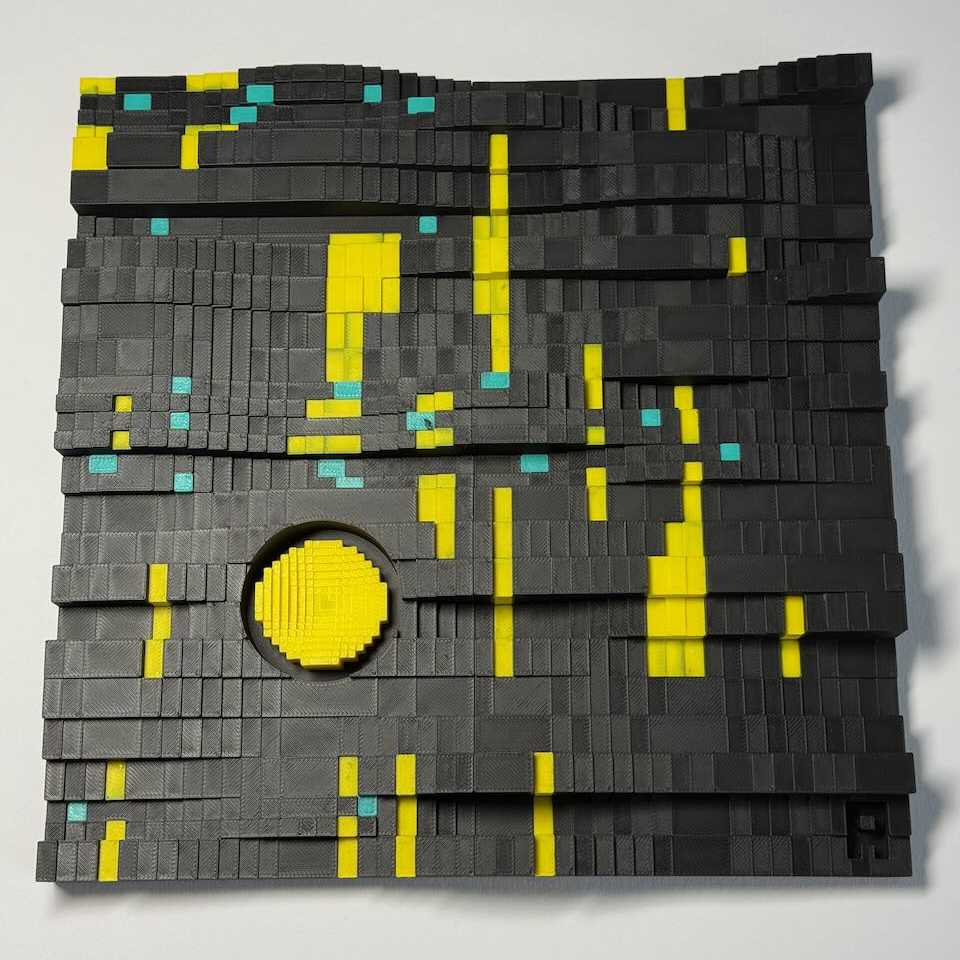

# Hi, I'm Florian 👋

Software dev by day and game dev by night (or sometimes the other way around), based in Munich, Germany.

With **over 20 years of experience in software engineering**, both as a developer and as an architect, I now run [**MobiusCode**](https://github.com/mobiuscode-com). Besides building software and tools, I like soldering things to Raspberry Pis and microcontrollers, designing things to 3D print, and making games and (sometimes) art.

---

## 💾 Software

### Current projects

**[Video-API](https://video-api.io)** *(closed alpha)* 
An AI-enabled video editing API for developers and professional video producers. You submit a job over REST and download the result. It handles cutting, merging, transcoding, automatic subtitles, text-to-speech voice-overs, overlays, and smart reframing for vertical formats.

**Nightshift** 
An autonomous delivery pipeline: a virtual development team limited only by the available AI inference capacity. Agents with different roles pick up issues, implement them in isolated workspaces, review each other's merge requests, fix the findings, and merge.

**Bagheera2** 
A CRM for independent (non-governmental) youth welfare providers. It covers clients, services and activity reports, and generates invoices for youth welfare offices and self-paying clients.

### Open source (selected)

| Project | What it is                                                                                                                | Tech |
|---|---------------------------------------------------------------------------------------------------------------------------|---|
| [**xdata**](https://github.com/entrusc/xdata) + [**xdata-explorer**](https://github.com/entrusc/xdata-explorer) | A library for reading and writing the xdata format (originally built for Exotic Matter), plus a GUI to browse xdata files | Java |
| [**dcpu**](https://github.com/entrusc/dcpu) | An emulator for the DCPU-16, the fictional CPU from *0x10c*                                                               | Java |
| [**slf4j-osgi**](https://github.com/entrusc/slf4j-osgi) · [**log-formatters**](https://github.com/entrusc/log-formatters) | Logging glue: an OSGi adapter for SLF4J and a set of `java.util.logging` formatters                                       | Java |

---

## 🔌 Hardware

### Current projects

**[Bluebridge](https://github.com/entrusc/bluebridge)** 
Connects an Iomega ZIP 100 parallel-port drive to USB. An RP2040 board emulates a PC printer port, so a modern machine can talk to the drive. GPL firmware and hardware.

### Open source (selected)

| Project | What it does | Tech |
|---|---|---|
| [**Pi-OLED**](https://github.com/entrusc/Pi-OLED) | A Java driver for the popular SSD1306 128×64 monochrome OLED display over I²C | Java |
| [**Pi-RC-Switch**](https://github.com/entrusc/Pi-RC-Switch) | Controls 433 MHz remote-controlled power outlets from a Raspberry Pi with an RF transmitter | Java |
| [**Pi-WS2812**](https://github.com/entrusc/Pi-WS2812) | A Java driver for WS2812 addressable LEDs | Java |
| [**Pi-RGB-LED**](https://github.com/entrusc/Pi-RGB-LED) · [**PiLightShow**](https://github.com/entrusc/PiLightShow) | RGB LED control (e.g. the PiBorg LedBorg) and a little Pi light show | Java |
| [**sptp**](https://github.com/entrusc/sptp) | A Simple Point-to-Point Protocol: a PlatformIO library for exchanging data over serial between a host and an embedded device | C++ |
| [**linux-lcd**](https://github.com/entrusc/linux-lcd) | A Raspbian kernel patched for the pi3g GPIO LCD display | C |
| [**openbeacon**](https://github.com/entrusc/openbeacon) | A branch of the OpenBeacon active RFID firmware | C |

---

## 🖨️ 3D Printing

I design models for 3D printing and publish them here:

- [**My Profile on Printables**](https://www.printables.com/@entrusc_485334)
- [**My Profile on MakerWorld**](https://makerworld.com/en/@entrusc)

---

## 🎮 Games

### [Exotic Matter](https://exoticmatter.io)
> *"Shipwrecked on an alien planet, light-years away from earth – your primary mission: survive."*

A single-player sci-fi sandbox adventure set on Xcylin, a fully simulated alien planet. You explore an open world and dig into procedurally generated underground facilities left by an extinct race. The engine is built for modding, and you can download community planets through the Steam Workshop.

[exoticmatter.io](https://exoticmatter.io) · 2018 · Windows & Linux · *unfinished*

### [Panic Mode](https://panicmodegame.com)
> *Crisis management with questionable engineering.*

As a safety inspector intern for Pamperümpel Industries, you build contraptions and evacuation routes to save its erratic, useless and adorable employees, the Pammies. The Pammies build with whatever they find, explosive or not.

Released on [Steam](https://store.steampowered.com/app/1529430/Panic_Mode/) in July 2021 · Windows, macOS & Linux

### Game jams
I've made several smaller games for **Ludum Dare**. Some of them are playable on my [itch.io page](https://entrusc.itch.io).

**🏆 [Plant Lab](https://entrusc.itch.io/plant-lab)**, Ludum Dare 34 (theme: *Growing*) 
A minimalist pixel-art simulation where you edit plants' DNA to make them grow bigger and faster. It placed in the **top 10 for Innovation**. Playable in the browser.

---

## 🎨 Art

  
   
  <i>Fractured Worlds</i> · exhibited in Erding, 2026

**Fractured Worlds** was designed digitally in [OpenSCAD](https://openscad.org/), with its surface shaped by Perlin/Simplex noise, and then 3D printed in PLA. It is part of a series of 26 similar but different pieces, marked **A** to **Z**. The piece was shown at an exhibition in Erding in 2026.

---

## 🛠️ Toolbox

---

<i>Building things since 2012 on GitHub, and a fair bit longer offline.</i>

